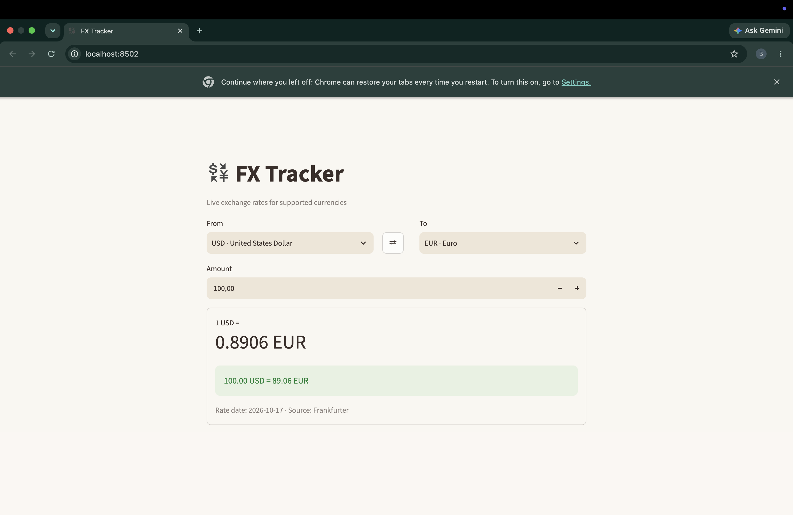
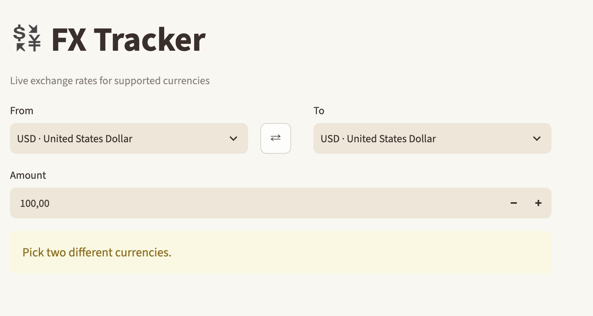
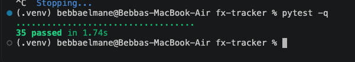

# FX Tracker
### Know what your money is really worth

Bebba Elmane · ASE 420
https://github.com/BElmane/fx-tracker

---

## Imagine this

Your family sends you **$500** from back home.

- How much will you **really** get?
- Is **today** a good day to convert, or should you wait?

Most people just guess.

---

## Why it matters

Exchange rates change **every day**.

If the USD to MAD rate goes from **9.78 to 9.60**, then on $500:

- 9.78 gives **4,890 MAD**
- 9.60 gives **4,800 MAD**

That's **90 MAD lost** just from bad timing.

---

## Who needs this?

- **Travelers** who want to know what their money is worth abroad
- **Students** whose families send money from another country
- **Anyone** who sends or converts money between currencies

---

## My solution: FX Tracker

A simple app that shows **live exchange rates** in seconds.

- **165 currencies**
- **Real data** from the Frankfurter API
- **Clean and easy**

---

## Demo: check a rate

Pick two currencies, type an amount, and get the answer right away. The swap button switches them.

---

## Demo: it doesn't break

- Same currency or amount 0: a friendly warning
- No internet: a clear message
- **The app never crashes**

---

## Sprint 1 results

| | Done | Planned | % |
|---|---:|---:|---:|
| Features | 3 | 3 | **100%** |
| Requirements | 2 | 2 | **100%** |

- **258** lines of app code
- **324** lines of test code
- **35** tests passing
- Extra: an amount converter and a swap button

---

## Burndown: remaining requirements

| Point | Remaining |
|---|---:|
| Start | 2 |
| End of Week 5 | 2 |
| End of Week 6 | 2 |
| End of Week 7 | 2 |
| End of Week 8 | **0** |

---

## Schedule: planned vs. actual

| Week | Planned | Actual |
|---|---|---|
| 5 | Repo, venv, start API | Repo and README, tested the API by hand |
| 6 | API, currency selection, rate | Chose Frankfurter v2 over v1 |
| 7 | Error handling, prototype | app structure |
| 8 | Test, record progress | Full prototype, 35 tests, PR #1 merged |

---

## How it's built

| Part | File | Job |
|---|---|---|
| Screen | `app.py` | Shows the rates to the user |
| Rules | `rate_service.py` | Checks input and converts money |
| Contract | `rate_provider.py` | Says what any data source must do |
| Data | `frankfurter_client.py` | Gets real rates from the API |

The rules only talk to the **contract**, not the API directly. So I can swap the data source later, and **nothing else changes**.

---

## The design ideas behind it

| Idea | What it does for the user |
|---|---|
| Abstraction | Can swap the data source anytime |
| Inheritance / Polymorphism | Real API and test version work the same way |
| Encapsulation | Rates can't be changed by mistake |
| Dependency Injection | Easy to test without internet |
| Single Responsibility | Screen, rules, and API are separate |
| No magic numbers | Settings live in one place |

---

## Cleaner code: one refactoring

- **Problem:** the same fake test objects were going to be copied into 2 files
- **Fix:** moved them into one shared file, `tests/fakes.py`
- **Result:** less code, one place to change

---

## Built to be trusted: 35 tests

| Type | Count | What it checks |
|---|---:|---|
| Unit | 21 | Each part on its own |
| Integration | 4 | Parts working together |
| Regression | 5 | Tricky cases stay fixed |
| Acceptance | 5 | Uses the app like a real user |

---

## What I learned (retrospective)

**Went well**
- The design made testing easy. Most tests run without internet.
- All 4 test types are done.

**Went wrong**
- Small mistakes: unsaved files, indentation, a typo in a file name

**What I'll do better**
- Small commits
- Run tests before every commit

---

## What's next: Sprint 2

The feature everyone wants:
### "Tell me when the rate is good."

- **Target rate alerts:** set a goal, get told when it's reached
- **Trend chart:** see if the rate is going up or down
- **Track many pairs** at once
- **Save rate history**

---

## Sprint 2 plan

- **MVP:** 5 new features, 3 new requirements
- **Design:** new parts in small classes with DI (like a storage class), plus a pattern that fits the alerts
- **Docs:** User Manual, Architecture Doc, GitHub Pages website
- **Tests:**
  - Unit: `test_history.py`, `test_alerts.py`
  - Integration: history, storage, and API together
  - Regression: all 35 Sprint 1 tests keep passing
  - Acceptance: add a pair, set a target, see the alert

---

## Sprint 2 timeline

| Weeks | Plan |
|---|---|
| 9 | Finalize the prototype, S1P |
| 10–11 | Review and refactor the Sprint 1 code |
| 12–13 | Multi-pair tracking, target rates, documents, website |
| 14 | Trend view and testing the new features |
| 15 | Finalize MVP and docs, submit (Dec 5) |

---
# Thank you!

**GitHub:** https://github.com/BElmane/fx-tracker
